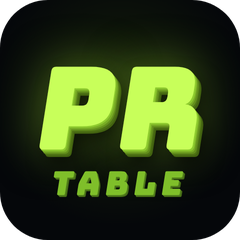
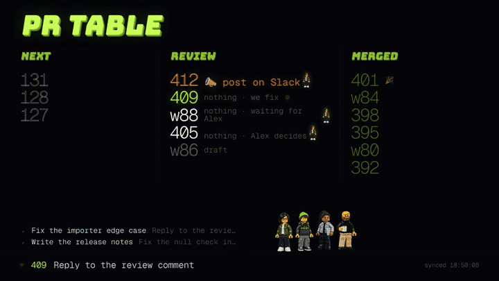
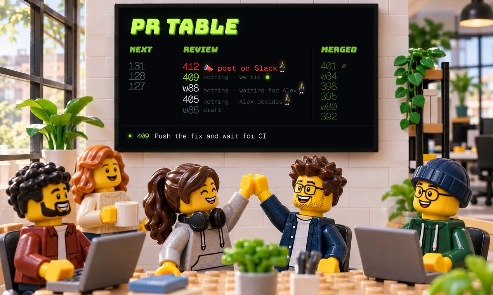
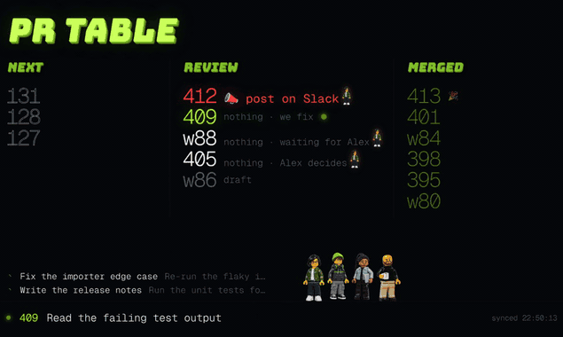

<p align="center"></p>

<h1 align="center">PR TABLE</h1>

<p align="center"><b>Mission control for teams that ship with AI.</b><br>A dedicated screen for your team's pull requests.<br>
Huge numbers you can read from across the room, the one thing you have to do in red, and a confetti party every time a PR merges.</p>

<p align="center"></p>

---

## Why

You ship with AI agents now. Five PRs in review, two agents fixing things, a reviewer somewhere in another timezone. The question you ask yourself all day is **"what do I have to do right now?"**

PR Table answers it on a spare monitor, without opening a single tab:

- **Next · Review · Merged**, in numbers big enough to read from your couch.
- **One action, in red.** Every PR gets a label that says what *you* do. Only one of them is an action: `📣 post on Slack`. Everything else starts with `nothing`.
- **Live from your Claude Code session.** It tails the session file, so the PR your agent is working on glows, and every sub-agent it launches gets its own spinning line while it works.
- **A reviewer alert.** When your reviewer comments, their name takes over the whole screen for 45 seconds.
- **A merge party.** Every merge triggers 20 seconds of 3D "MERGED", shockwaves, confetti and your crew jumping around.

<p align="center"></p>

<p align="center"></p>

## Quick start (60 seconds, no setup)

```bash
git clone https://github.com/kabylesystem/pr-table && cd pr-table
python3 server.py --demo
```

Open http://127.0.0.1:4950 and press F11. The demo invents PRs, agents and a merge every 45 seconds.

## Use it for real

1. `cp config.example.json config.json` and fill in your GitHub login, your repos and your reviewer.
2. Log in to GitHub once: `gh auth login` (or export `GITHUB_TOKEN`).
3. `python3 server.py`, then open http://127.0.0.1:4950 fullscreen on your second monitor.

Linux users can let `bin/pr-table` do the fullscreen part: `bin/pr-table` toggles a kiosk window on your external monitor (Chromium, Chrome, Brave or Edge, with Hyprland support), `bin/pr-table party 1234` replays the merge animation for whoever is watching. A ready-made systemd unit lives in `contrib/pr-table.service`.

For a team screen, run it on any machine and open it from the TV or Raspberry Pi on your network: `python3 server.py --host 0.0.0.0`, then browse to `http://<that-machine>:4950`.

Requirements: Python 3.10+ (standard library only), a GitHub token, any modern browser.

## What each label means

| Label | When | What you do |
|---|---|---|
| `📣 post on Slack` (red) | Your reviewer is requested, required checks are green, 0 unresolved threads, the PR description contains your ready marker (`Open points: none` by default), and nobody posted about it on Slack since the last push | Post it or ping again. The line disappears within 15 s once you do. |
| `nothing · we fix` | A review thread is still open, the reviewer requested changes after your last push, or you pushed after their review and still have to re-request them | Nothing, your agent is on it |
| `nothing · waiting for <reviewer>` | Reviewer requested, nothing new from them | Nothing |
| `nothing · <reviewer> decides` | Set by you in `data/status.json` when the call is theirs | Nothing |
| `paused`, `draft` | `data/paused.json`, or a draft PR | Nothing |

The red line is built to be boringly stable: it survives restarts (state is cached), a single failed check run or API hiccup never hides it, and every time it appears or disappears the reason is written to `~/.cache/pr-table/ask.log`.

## Configuration

`config.json` (see `config.example.json`):

| Key | What it does |
|---|---|
| `github.author` | Whose PRs to show |
| `github.repos` | Repos to watch, each with a short `label` prefix (`""`, `w`, …) so `w42` means PR 42 of the second repo |
| `reviewer` | GitHub login, display name and figure of the person whose comments matter |
| `crew` | The figures that walk along the bottom and jump at every merge |
| `ready_marker` | Text that marks a PR description as ready for review |
| `next.clones` + `next.branch_pattern` | Local branches that match and have no PR yet show up in **Next** |
| `claude.session_file` | Pin a Claude Code session file. Leave empty to follow the most recent session, or set `claude.hyprland_workspace` to follow the one running in a given workspace |
| `slack` | Optional. A token in `$SLACK_TOKEN` with `channels:history` and the channel id where PRs get posted (`#123` or `w#42` at the start of a message) |

GitHub is polled every 10 s with ETags, so unchanged responses cost nothing against your rate limit. The bottom right corner shows the last successful sync and turns red past 60 s.

## Make the crew look like your team

The four default figures are fictional and generated. `scripts/prompts.json` holds the exact prompts and `scripts/gen_images.py` regenerates them:

```bash
export OPENAI_API_KEY=sk-...
python3 scripts/gen_images.py crew
```

To turn real teammates into figures from a photo, see [PROMPTS.md](PROMPTS.md). Ask them first.

## Styles

The default look is the 3D title with the crew walking on the bottom line. Try others with URL parameters:

- `?look=1` neon sign, `2` giant drifting outline, `3` glitch, `4` departures board, `5` 3D (default)
- `?fig=1` lined up after the title, `2` two pairs, `3` standing on the table, `4` walking (default), `5` framing the title
- `?celebrate=1234` plays the merge animation once on load

## Privacy

Everything runs on your machine. PR Table talks to the GitHub API, and to Slack only if you configure it. It reads your Claude Code session files locally and never sends them anywhere.

## License

MIT. Fonts: Bungee and Geist Mono (SIL Open Font License), loaded from Google Fonts.
